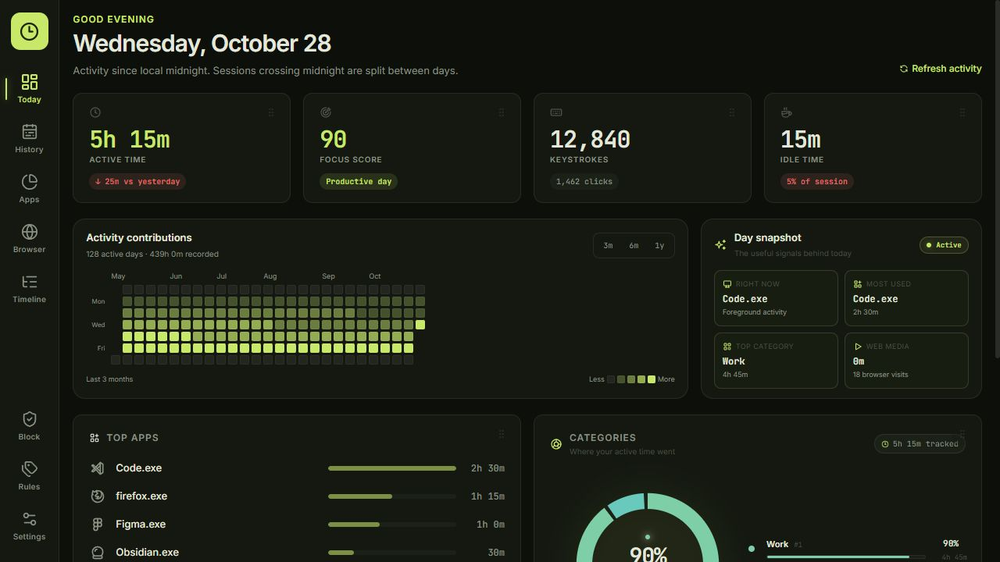
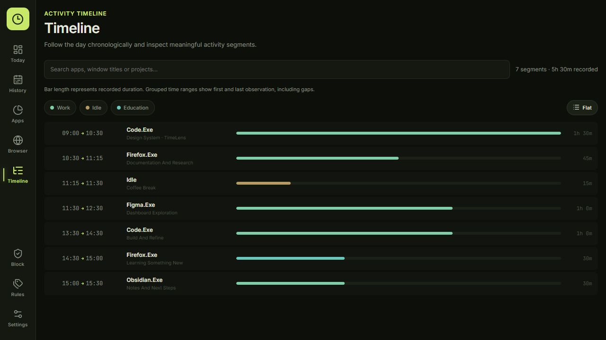
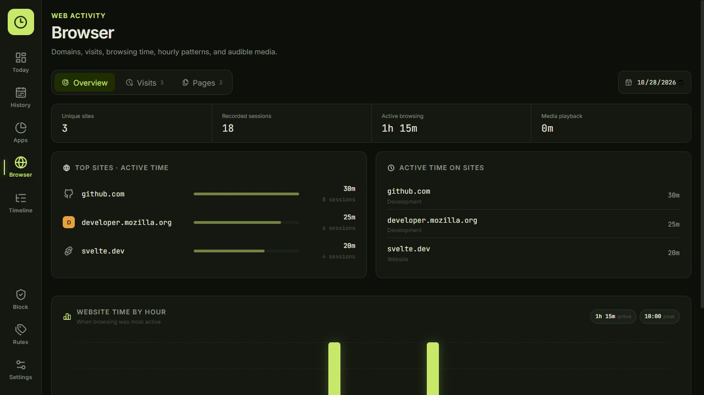

# TimeLens

### Know where your time goes. Keep your activity yours.

Private activity insights for your computer and phone. Understand your habits, see your day clearly, and make room for focused work—without an account or a cloud activity store.

[**Explore TimeLens**](https://timelens.venusapp.in) · [**Downloads**](https://github.com/YumiNoona/TimeLens/releases) · [**Firefox extension**](https://addons.mozilla.org/en-US/firefox/addon/timelens-tracker/) · [**Documentation**](https://timelens.venusapp.in/docs)

---

<em>The real TimeLens dashboard, shown with synthetic example activity. No personal history is included.</em>

## Your day, in focus

TimeLens turns everyday app and browser activity into a clear picture of how you spend your time. Check your daily overview, explore a timeline, look back at patterns, or add a little friction to distractions.

- **See where the hours went.** Understand foreground app time, categories, idle periods and historical trends.
- **Go beyond a total.** Explore chronological activity, application breakdowns and website context.
- **Keep browsing in perspective.** Browser companions distinguish focused browsing from supported media playback.
- **Make focus personal.** Organize activity with rules and categories, and use blocking controls when you want fewer distractions.
- **Choose what stays private.** Exclude activity, hide sensitive titles, pause collection, control retention and export your history.
- **Keep things lightweight.** A native Windows tray app and a native Android app, with work kept local.

## A closer look

### Follow the story of your day

See when your attention moved between apps, where focused stretches happened, and where breaks fit in. A timeline gives context that a single screen-time number cannot.

### Understand your browser time

Explore observed websites and pages, visits and focused browsing time. Supported media information is reported separately so background playback is not confused with foreground browsing.

All screenshots use synthetic example data in the actual dashboard interface. They are not mockup designs or live personal records.

## On your computer, phone and browser

| Experience | What it does |
| --- | --- |
| **Windows app + web dashboard** | Runs in the tray and opens a local dashboard in your browser. Includes activity history, timelines, categories, privacy controls, focus blocking and optional offline-work review. |
| **Android app** | A native phone experience with Today, Apps, History, Block and Settings. Includes goals, categories, local reports, Comfort allowances, Strict blocking and optional browser integration. |
| **Firefox & Chrome companions** | Add website and tab context to the Windows app after local pairing. The Firefox store listing is the recommended signed installation; release ZIPs are developer packages. |
| **TimeLens website** | Product information, downloads and documentation. It is not a cloud-hosted copy of your activity history. |

Each device keeps its own local history. Windows and Android do not currently sync activity or pair with one another.

### Android, made for your phone

Use filled and outlined navigation icons, choose a light or dark appearance—or follow your system—and switch themes without losing your place. Browse your history, set personal goals, and choose a rolling Comfort allowance or a Strict block for distractions.

Optional website integration uses known address-bar controls for supported browsers, including Brave, Chrome, Firefox, Edge, Samsung Internet, Vivaldi and DuckDuckGo. Browser updates, hidden bars and device restrictions can leave gaps; this is not exhaustive browsing-history capture.

[Android features, setup and build guide →](android/README.md)

## Privacy is part of the product

Activity is stored locally on the device where it was collected. There is no required account, telemetry service or cloud activity database.

On Windows, keyboard and mouse statistics are aggregate counts—not a recording of what you type. Privacy exclusions, title controls and recording pauses help limit new collection. Optional offline work is disabled until you enable it in Settings.

Android uses permissions you explicitly grant for usage insights and optional blocking/browser integration. The app does not request Internet access. History leaves the device when you choose to export or share it.

Blocking is a personal focus aid, not device-owner lockdown. Android's owner can still disable Accessibility or uninstall the app. Available controls and permission requirements differ by platform.

## Get started

**Windows:** download a Windows build, launch TimeLens, and open the dashboard from the tray. Add a browser companion if you want website context.

**Android:** review the APK's release notes and permission disclosures before installing. Android builds are currently previews; signing identities matter when replacing an existing installation. Export any history you want to keep before uninstalling an app.

**Browser companions:** use the official Firefox listing or review the developer packages in Releases. Companions need the local Windows app; they are not standalone cloud trackers.

[Browse downloads →](https://github.com/YumiNoona/TimeLens/releases) · [Read the documentation →](https://timelens.venusapp.in/docs)

## Explore the project

- [Windows app and local API](src/TimeLens.TrayApp)
- [Web dashboard](src/TimeLens.Dashboard)
- [Android app](android)
- [Browser companions](src/browser-extensions)
- [Public website](web)
- [Tracking and accounting details](docs/tracking.md)
- [Documentation screenshot setup](docs/screenshots/README.md)

---

Built with 💙 by <a href="https://venusapp.in/">Veil</a>

